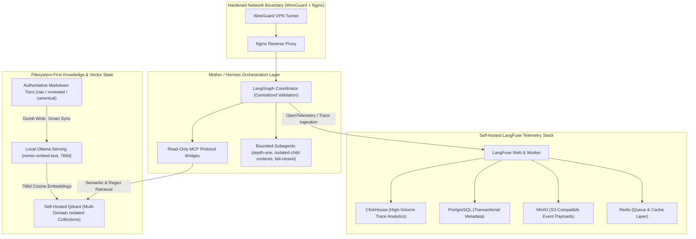

# Tanya Public Showcase — Mother / Hermes Subagentic RAG Platform

**Architect & Operator:** Rafael Viotti (`Senior AI Engineer (Contract)` · **Systems & Reliability Foundation**)  
**Status:** Active Self-Hosted Production Environment (Sanitized Public Architecture Mirror)

---

## 1. Architectural Overview

**Mother / Hermes** is a self-hosted subagentic Retrieval-Augmented Generation (RAG) and long-term memory platform running on dedicated Linux hardware (**Tanya**). Built upon **~46 months** of hands-on infrastructure, NOC network monitoring, operational integrity, and AI engineering experience (including **6 months** as **Sole architect and developer** of business AI systems at MaxStartup), the platform treats operational reliability, boundary isolation, and deterministic state recovery as first-class primitives.

---

## 2. Core Engineering Pillars

### 2.1 Bounded Subagent Delegation (`depth-one`)
- **Centralized Orchestration:** A parent coordinator dispatches specialized workers via LangGraph with strict contract validation.
- **Depth-One Isolation:** Subagents operate with a maximum spawn depth of one (`depth-one`), preventing recursive agent loops, runaway token consumption, and cross-task context contamination.
- **Fail-Closed Execution:** Unverified tool outputs, schema mismatches, or timeout conditions trigger deterministic fallback paths rather than silent hallucination.

### 2.2 Multi-Domain Vector Retrieval & Local Embeddings (`768d`)
- **Filesystem-First Truth:** Knowledge is persisted on disk across three explicit trust tiers (`raw`, `reviewed`, and `canonical`). The vector database is treated as a derived, rebuildable index rather than fragile primary storage.
- **Multi-Domain Isolation:** The self-hosted Qdrant cluster uses a **Multi-Domain** collection architecture with collection-per-domain isolation to prevent cross-domain retrieval leakage.
- **Zero-API-Cost Local Embeddings:** All semantic indexing and query vectors are generated locally via Ollama running `nomic-embed-text` (`768d` cosine similarity), eliminating external embedding API latency and per-query billing.

### 2.3 MCP Protocol Bridges (`tanya-memory`)
- **Read-Only Semantic Interfaces:** Client workspaces consume knowledge from Qdrant through dedicated **MCP protocols** (`search_memory`, `grep_memory`, `get_memory`, `list_collections`) exposed over authenticated SSH/WireGuard tunnels.
- **Write-Path Separation:** Workstation agents never mutate vector collections directly over REST; instead, they write auditable Markdown artifacts that the background ingestion daemon validates, chunks, and indexes asynchronously.

### 2.4 Self-Hosted LangFuse Observability Stack
- **Full-Stack Telemetry:** Runs a complete **Self-hosted LangFuse** deployment composed of LangFuse Web, asynchronous Worker, ClickHouse, PostgreSQL, MinIO, and Redis services.
- **Operational Visibility:** Captures end-to-end trace latency, prompt/completion token economics, retrieval quality scores, and subagent decision trees.

### 2.5 Hardened Linux Operations & Rehearsed Recovery
- **Network Boundary:** All internal endpoints (Qdrant, Ollama, **Self-hosted LangFuse**, MCP bridges) sit behind a WireGuard-only nginx boundary managed via hardened `systemd` units.
- **Rehearsed Recovery Drills:** Documented and exercised procedures for rebuilding **Multi-Domain** Qdrant collections from `canonical` and `reviewed` Markdown sources, verifying PostgreSQL/ClickHouse state backups, and restoring service health under L1/L2 operational incident protocols.

---

## 3. Sanitization & Governance Contract

This showcase follows strict public-release hygiene:
- **Resilient Qualitative Metrics:** Describes structural capabilities (**Multi-Domain** collections, `768d` vectors, **Self-hosted LangFuse** stack) rather than volatile point-in-time counters.
- **Zero Private Infrastructure Exposure:** All internal RFC1918 addresses, private mount paths, WireGuard keys, and personal vault contents are excluded by automated governance checks.

---

## 4. Engineering Changelog (Distilled Public Milestones)

- **2026-10 — Factual & Privacy Governance Automation:** Added deterministic pre-publish verification (`verify-cv-facts.mjs` + Privacy Gate P-01) enforcing strict alignment between public documentation and verified architectural state.
- **2026-10 — Hybrid Agent Memory & Smart Sync:** Established asynchronous Markdown-to-Qdrant (`768d` `nomic-embed-text`) synchronization with retry queuing and timeout guards across **Multi-Domain** collections.
- **2026-10 — Read-Only MCP Memory Bridge:** Standardized **MCP protocols** for semantic (`768d`), regex, and payload-by-ID retrieval across allowlisted Qdrant collections over persistent encrypted tunnels.
- **2026-09 — Self-Hosted LangFuse Telemetry Pilot:** Deployed and validated the multi-service **Self-hosted LangFuse** observability stack (Web, Worker, ClickHouse, Postgres, MinIO, Redis) behind the WireGuard + Nginx boundary.
- **2026-08 — Mother / Hermes Core & Trust-Tier Storage:** Designed the filesystem-first knowledge hierarchy (`raw` / `reviewed` / `canonical`) and bounded `depth-one` subagent delegation model.
